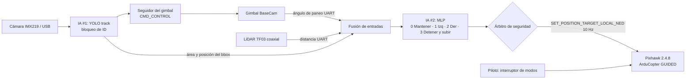
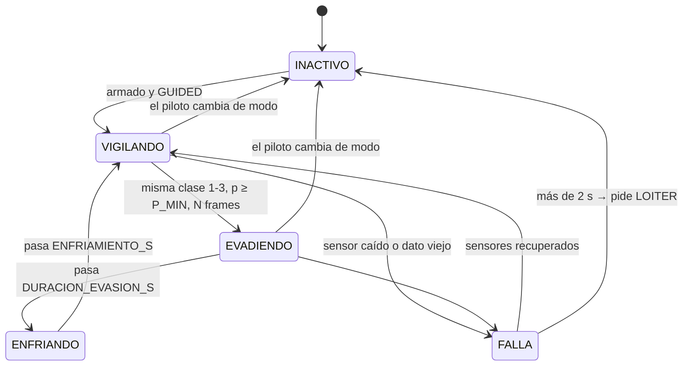

# Sistema de detección de personas y evasión — código del proyecto de grado

Ingeniería Aeronáutica, Universidad de San Buenaventura.
Jetson Orin Nano + Pixhawk 2.4.8 (ArduCopter) + cámara IMX219/USB + LiDAR TF03 + gimbal BaseCam.

> **Copia del repositorio (2026-10-11).** Es el código de `~/Escritorio/dron_ia/` en la Jetson, sin respaldos
> (`*.orig`, `*.bak-*`), modelos (`.pt`, `.onnx`, `.engine`: el motor TensorRT se regenera en cada equipo con
> `yolo export model=yolo26n.pt format=engine half=True`), imágenes, patrones `.npy` ni registros.
> Los números de serie de `config.py` y la IP de `visor_web.py` se reemplazaron por `<NUMERO_DE_SERIE>` e
> `<IP-de-la-Jetson>`: antes de usarlo, ponga los suyos (`ls -l /dev/serial/by-id/`).
>
> **Lo que cambió respecto al texto de abajo (que es anterior):**
> - Pixhawk ↔ Jetson por **TELEM2 ↔ `/dev/ttyTHS1` a 115200** (a 460800 y 921600 la Pixhawk no entiende lo que
>   transmite la Jetson). `BRD_SER2_RTSCTS = 0`. El USB Pixhawk-Jetson solo en banco: retroalimenta 5 V.
> - LiDAR por el adaptador PL2303 (driver `pl2303` compilado aparte para el kernel L4T) y gimbal por su mini-USB.
> - Gimbal de 2 ejes: el pitch se manda por PWM desde **AUX1 de la Pixhawk** (`MAV_CMD_DO_SET_SERVO`,
>   `pwm = 1500 + θ·500/45`); la placa SimpleBGC 2.2b2 solo **lee** ángulos por serie (`REALTIME_DATA`).
> - Cámara principal USB (HFOV medido 38.9°). La CSI IMX219 funciona con ISP por software (`camara_csi.py`,
>   `CAMARA_TIPO = "csi_v4l2"`) porque en JetPack 7 nvargus no arranca; queda como respaldo.
> - Nuevos: `camara_csi.py`, `visor_web.py` (visor en el navegador, lanzador en `herramientas/visor.sh`),
>   `capturar_patron.py` y `correccion_camara.py` (cuadrícula de la cámara USB sin IR-cut).
> - `vuelo_evasion.py`: giro de yaw hacia la persona y opción `--sin-modelo` (no forman parte del mínimo del comité).
> - Detalle y decisiones en [docs/jetson.md](../docs/jetson.md) y [docs/PLAN_MINIMO_FISICO.md](../docs/PLAN_MINIMO_FISICO.md).

## Archivos

| Archivo | Qué hace | Dónde corre |
|---|---|---|
| `config.py` | Todos los puertos, umbrales y velocidades | — |
| `gimbal_basecam.py` | Lee el ángulo de paneo (SimpleBGC Serial API) y centra a la persona con el gimbal | Jetson |
| `lidar_tf.py` | Lee el TF03 (trama de 9 bytes) | Jetson |
| `percepcion.py` | Cámara (CSI por GStreamer o USB) + YOLO `track()` con bloqueo de ID | Jetson |
| `sensores.py` | Une cámara + YOLO + LiDAR + gimbal; incluye una fuente sintética para simulador | Jetson |
| `comun.py` | Entradas de la IA #2 (idénticas al grabar y al volar), carga del modelo y HUD | Ambos |
| `grabar_dataset.py` | Graba el CSV con etiquetas por teclado (0–3) | Jetson |
| `entrenar_mlp.py` | Entrena el MLP y exporta `decision.pkl` + `decision_pesos.json` + figuras | PC |
| `vuelo_evasion.py` | Percepción → MLP → árbitro de seguridad → MAVLink en GUIDED | Jetson |

## 1. Instalación en la Jetson

```bash
python3 -m venv --system-site-packages ~/venv_dron     # hereda OpenCV con GStreamer
source ~/venv_dron/bin/activate
pip install -r requirements_jetson.txt
sudo usermod -aG dialout $USER                          # acceso a puertos seriales (reiniciar sesión)
```

Recomendado para YOLO en la Jetson: exportar a TensorRT y poner el `.engine` en `YOLO_MODELO`:
`yolo export model=yolo26n.pt format=engine half=True`

## 2. Conexiones y puertos

* **Pixhawk TELEM2 ↔ UART de la Jetson** (pines 8 TX, 10 RX, 6 GND del header de 40 pines). TX con RX cruzados y GND común; **no conecte el cable de 5 V**. En la Orin Nano suele ser `/dev/ttyTHS0`; confírmelo con `ls -l /dev/ttyTHS*`.
* **LiDAR y gimbal por adaptadores USB-TTL.** `/dev/ttyUSB0` y `/dev/ttyUSB1` pueden intercambiarse al reiniciar. Use las rutas fijas que Linux crea solo:
  `ls -l /dev/serial/by-id/` (o `/dev/serial/by-path/` si los dos adaptadores son idénticos) y copie esas rutas a `config.py`.

## 3. Parámetros de ArduPilot (Mission Planner)

| Parámetro | Valor | Motivo |
|---|---|---|
| `SERIAL2_PROTOCOL` | 2 | MAVLink 2 en TELEM2 |
| `SERIAL2_BAUD` | 921 | 921600 baudios, igual que `BAUD_PIXHAWK` |
| `FLTMODE1..6` | incluir STABILIZE, LOITER y **GUIDED** | el piloto entra y sale de GUIDED con el interruptor |
| `GUID_TIMEOUT` | 3 (por defecto) | si la Jetson deja de enviar, el dron frena solo |
| `FENCE_ENABLE` / `FENCE_TYPE` / `FENCE_ALT_MAX` / `FENCE_RADIUS` / `FENCE_ACTION` | 1 / 3 / 20 / 30 / 1 | geocerca: techo de 20 m y radio de 30 m, con RTL si se sale |
| `BATT_LOW_VOLT` / `BATT_CRT_VOLT` | 13.5 / 13.2 | los umbrales que ya ajustaron (así se llaman en ArduCopter 4.x) |
| `BATT_FS_VOLTSRC` | 1 | usa voltaje **compensado por caída (sag)**: ataca justo el problema de los aterrizajes falsos |

**GUIDED necesita GPS con fijación 3D.** El hardware listado no menciona el GPS: sin él la Pixhawk rechaza el cambio a GUIDED.

## 4. Paso a paso

### 4.1 Gimbal (hélices retiradas)
```bash
python3 gimbal_basecam.py                   # imprime PANEO en vivo; gire el pod a mano
python3 gimbal_basecam.py --prueba-signos   # mueve el pod, pregunta y dice qué signos poner en config.py
```
* `GIMBAL_FUENTE_PANEO = "marco"` usa `CMD_GET_ANGLES_EXT`: ángulo cámara-vs-chasis, que es el que importa para evadir. Si la placa no responde, el código pasa solo a `CMD_GET_ANGLES` (yaw de la IMU, relativo al arranque) y lo avisa.
* Si no hay respuesta: pruebe `--protocolo 2`, revise baudios (115200 de fábrica), TX/RX cruzados y GND común, y cierre el SimpleBGC GUI (el puerto no puede estar abierto por dos programas a la vez).

### 4.2 Dataset (dron en estático, sin hélices)
```bash
python3 grabar_dataset.py                # teclas: 0-3 etiqueta, R grabar/pausar, C cero gimbal, T seguimiento, Q salir
```
* **Elija la etiqueta antes de pulsar R.** Cada R inicia una *toma*; grabe muchas tomas cortas (20–40) en lugar de pocas largas: el entrenamiento evalúa con tomas que el modelo no vio.
* Varíe distancias (1–12 m), lados (paneo −60° a +60°), velocidades, ropa, fondo y dos personas cruzándose.
* Escriba antes un **criterio de etiquetado** (por ejemplo: «a más de 6 m → 0; entre 2.5 y 6 m con la persona a la izquierda → 2») y aplíquelo siempre igual. Ese criterio va al documento como protocolo experimental.
* En pantalla: la cruz roja es donde pega el láser. El recuadro es verde si el láser toca a la persona y naranja si no; en ese caso la distancia se estima por el tamaño del bbox (`fuente_distancia = bbox`).

### 4.3 Entrenamiento (PC)
```bash
pip install -r requirements_pc.txt
python entrenar_mlp.py "datos/*.csv"
```
Copie `decision.pkl` **y** `decision_pesos.json` a la Jetson. Si el `.pkl` no carga por versiones, el vuelo usa el JSON (mismo resultado, verificado al entrenar). En `resultados_entrenamiento/` quedan `matriz_confusion.png`, `curva_aprendizaje.png` y `reporte.txt` para el documento.

### 4.4 Pruebas escalonadas antes de volar
1. **Banco, sin Pixhawk:** `python3 vuelo_evasion.py --simulacion --sin-pixhawk --ventana` → se ve qué decidiría, sin enviar nada.
2. **Banco con Pixhawk conectada (sin hélices):** `python3 vuelo_evasion.py --simulacion` → confirma que lee modo, armado y altura.
3. **Simulador ArduPilot SITL en el PC:** con `sim_vehicle.py -v ArduCopter --out=udp:127.0.0.1:14551` corriendo, `python3 vuelo_evasion.py --conexion udp:127.0.0.1:14551 --sensores-falsos --sitl-despegue 5` → prueba el lazo MAVLink completo con una persona sintética. `--sitl-despegue` se niega a funcionar en un puerto serial.
4. **Vuelo real (exterior, zona despejada, observador y piloto de seguridad):** `python3 vuelo_evasion.py`. Despegar en STABILIZE, pasar a LOITER (confirma GPS), subir a más de 2 m y pasar a GUIDED. Para recuperar el mando, cualquier otro modo del interruptor.

## 5. Qué garantiza el árbitro de seguridad

El MLP propone y el árbitro decide. El script **nunca arma, nunca despega y nunca pone GUIDED por su cuenta**; si el piloto cambia de modo, deja de enviar y no insiste. Además:

* Evadir exige probabilidad ≥ `P_MIN` en `N_CONFIRMACION` frames seguidos. Frenar es inmediato.
* La maniobra dura `DURACION_EVASION_S` sin oscilar y termina con un freno de `ENFRIAMIENTO_S`.
* Nunca avanza hacia una persona detectada. Hay techo de ascenso (`ALT_MAX_M`) y altura mínima para maniobrar (`ALT_MIN_OPERACION_M`).
* Si falta cámara, YOLO, LiDAR o gimbal, se detiene. Si la falla dura más de 2 s, pide LOITER. Al cerrar el script con Ctrl+C también frena y pide LOITER.
* Los setpoints van en `MAV_FRAME_BODY_OFFSET_NED` (x adelante, y derecha, z abajo), con `yaw_rate = 0` para que el dron no gire la nariz al desplazarse.





## 6. Registro de vuelo (evidencia para el segundo objetivo específico)

Cada ejecución crea `logs/vuelo_FECHA.csv` con una fila por ciclo (10 Hz): modo, armado, altura, voltaje, estado del árbitro, distancia y su fuente, paneo, clase y probabilidad del MLP, velocidades enviadas, edad del dato de percepción, latencia de YOLO y duración del ciclo. Con esto se miden **activación** (cambios a GUIDED), **comunicación** (tasa de setpoints y HEARTBEAT) y **respuesta** (tiempo desde que aparece la persona hasta el inicio de la maniobra). `--video hud.avi` graba además el video con el HUD.

## 7. Qué hay que verificar en el hardware real

El código se probó contra un autopiloto ArduCopter simulado por MAVLink, una placa SimpleBGC simulada en un puerto serial virtual y tramas del TF03. El CRC de la BaseCam coincide con la implementación de referencia en C. Aun así, en el equipo real hay que confirmar:
* Los signos del gimbal (`--prueba-signos`) y que el firmware responda a `CMD_GET_ANGLES_EXT`.
* `CAMARA_HFOV_DEG` medido con su lente (afecta el seguimiento y la distancia estimada por bbox).
* Cómo reporta el TF03 la intensidad y la ausencia de retorno. Hoy se trata `0` y `≥ 18000` como sin retorno y no se filtra por intensidad.
